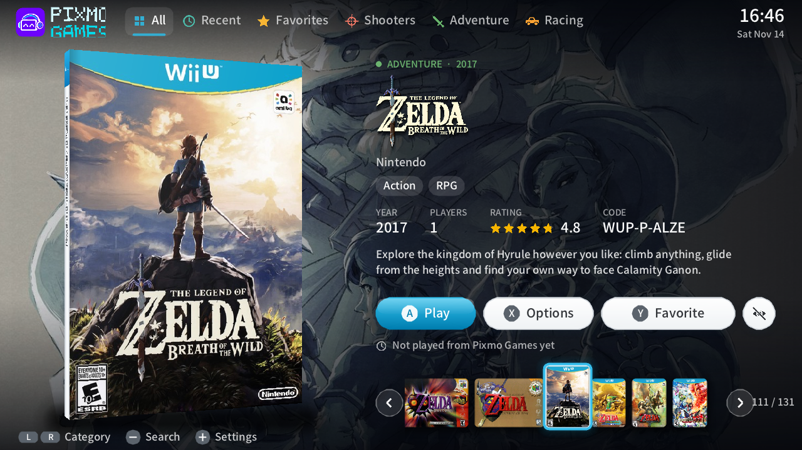
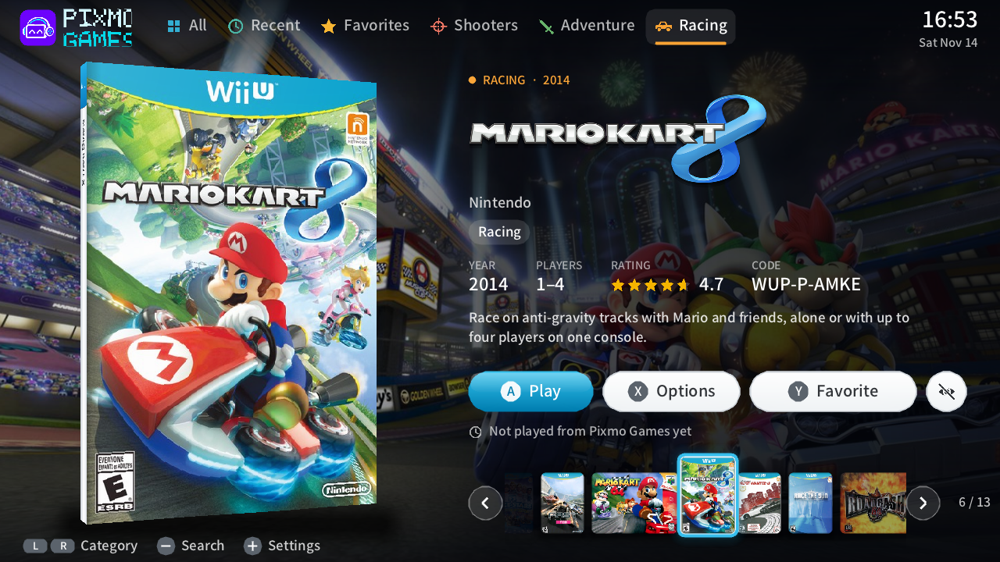
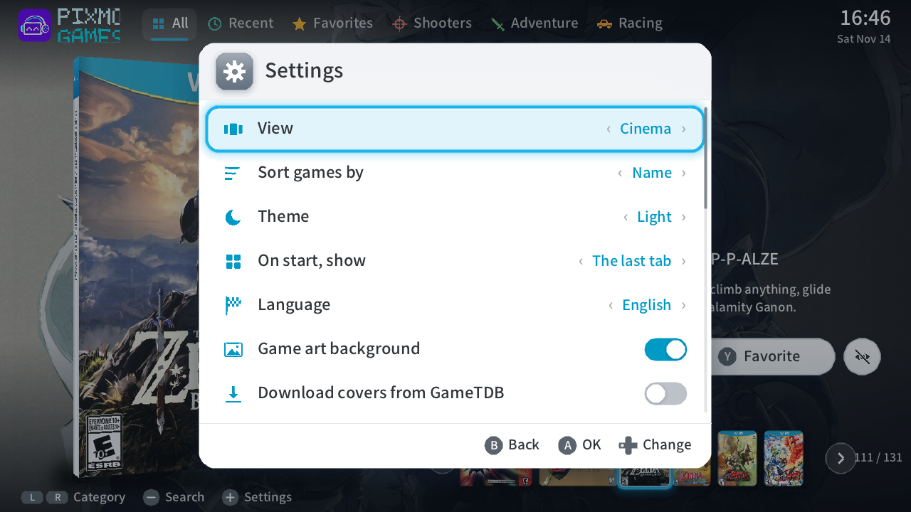

  

<h1 align="center">Pixmo Games</h1>

  A good-looking game library for the Wii U (Aroma) · Una biblioteca de juegos para Wii U (Aroma) 
  <a href="#español">Leer en español</a>

  
   Cinema view with background art and a title logo from the SD card (optional: without them it uses the game's own boot image and name).

Pixmo Games is a homebrew launcher for the games installed on your Wii U. It
opens in the **Cinema** view: the game's art fills the TV, its box spins up in
3D and its details sit next to it. Everything installed shows up in one place,
including Wii and GameCube games, Virtual Console and Aroma homebrew.

## Features

- **Three views**: Cinema (full-screen art, 3D box, cover carousel), Showcase
  and Grid, with a light or dark theme.
- **All your games**: Wii U games and demos, Virtual Console, Wii and GameCube
  games installed for the Wii U (eShop or injected), and `.wuhb` homebrew on the
  SD card. Updates and DLC are shown on the game's page.
- **Wii and GameCube games** start like from the Wii U Menu: choose GamePad,
  Wii Remote on the TV or Wii Remote on the GamePad screen.
- **Categories** with 28 icons, colors and your own logos; favorites; recent
  games; search with the console keyboard; hide games you do not want to see.
- **Covers downloaded from GameTDB**, or your own covers, background art and
  title logos from the SD card. Covers load once and stay cached.
- **Open at power-on and come back after a game** (optional Aroma plugin):
  close a game with HOME and you are back in Pixmo Games. Hold B to stay in the
  Wii U Menu.
- **Music**: soft ambient music, or your own songs.
- **English and Spanish**, following the console language.
- Works with the GamePad, Pro Controller, Wii Remote and the touch screen.

  
  

## Install

You need a Wii U with [Aroma](https://aroma.foryour.cafe), preferably up to date.

1. Download the latest `PixmoGames-v<version>.zip` from the Releases page.
2. Copy its `wiiu` folder to the root of your SD card. You get
   `SD:/wiiu/apps/pixmogames/pixmogames.wuhb`.
3. Optional, to open Pixmo Games at power-on and return to it after closing a
   game: also copy the `wiiu` folder inside `autostart_plugin_optional`. It
   adds `SD:/wiiu/environments/aroma/plugins/pixmo_inicio.wps`.
4. Start the console with Aroma: Pixmo Games is in the Wii U Menu.

The full guide is in [README.txt](README.txt) (English) and
[LEEME.txt](LEEME.txt) (Spanish): controls, categories, covers, music and
troubleshooting.

## Build from source

| What | Command | Output |
|---|---|---|
| App (Wii U) | `./build-wiiu.ps1` (PowerShell 7 + Docker) | `build-wiiu/pixmogames.wuhb` |
| Autostart plugin | `./build-plugin.ps1` (PowerShell 7 + Docker) | `plugin/pixmo_inicio.wps` |
| PC test build (Linux/WSL, SDL2) | `bash build-pc.sh` | `build-pc/ludoteca` |

The app uses wut and SDL2 from a pinned `devkitpro/devkitppc` image; the
plugin uses the `ghcr.io/wiiu-env` images (WiiUPluginSystem + librpxloader).
Developer notes, in Spanish: [docs/DESARROLLO.md](docs/DESARROLLO.md).
Translations live in `src/i18n.c`; `py -3 tools/check_i18n.py` checks that
every interface text has its English version.

## License

The code is under the [MIT license](LICENSE). The Pixmo Games name, logo and
mascot are the project's brand. Third-party components and their licenses are
listed in [THIRD_PARTY_NOTICES.md](THIRD_PARTY_NOTICES.md).

Pixmo Games is not affiliated with or endorsed by Nintendo. Covers come from
GameTDB; the console's own font is used at runtime.

---

## Español

Pixmo Games es un menú homebrew para los juegos instalados en tu Wii U. Abre en
la vista **Cine**: el arte del juego llena la TV, la caja se ve en 3D y al lado
va la ficha. Todo lo instalado aparece en un solo lugar, también los juegos de
Wii y GameCube, la Consola Virtual y el homebrew de Aroma.

**Qué tiene**

- Tres vistas (Cine, Vitrina y Cuadrícula), tema claro u oscuro.
- Todos tus juegos: de Wii U, demos, Consola Virtual, juegos de Wii y GameCube
  instalados para Wii U (eShop o inyectados) y homebrew `.wuhb` de la SD.
- Los juegos de Wii y GameCube se inician como desde el menú Wii U, eligiendo
  GamePad, Wiimote en la TV o Wiimote en el GamePad.
- Categorías con 28 iconos, colores y logos propios; favoritos; recientes;
  búsqueda; juegos ocultos.
- Carátulas de GameTDB o propias, con fondos y logos de títulos desde la SD.
- Abrir al encender y volver después de un juego (plugin opcional de Aroma):
  cierras el juego con HOME y vuelves a Pixmo Games. Mantén B para quedarte en
  el menú Wii U.
- Música ambiental o tus canciones.
- En español e inglés, según el idioma de la consola.

**Instalar**: necesitas una Wii U con [Aroma](https://aroma.foryour.cafe).
Descarga el último `PixmoGames-v<versión>.zip`, copia su carpeta `wiiu` a la raíz de la SD y,
si quieres que se abra al encender, copia también la carpeta `wiiu` de
`autostart_plugin_optional`. La guía completa está en [LEEME.txt](LEEME.txt).

Código bajo licencia MIT. Pixmo Games no está afiliado a Nintendo.
